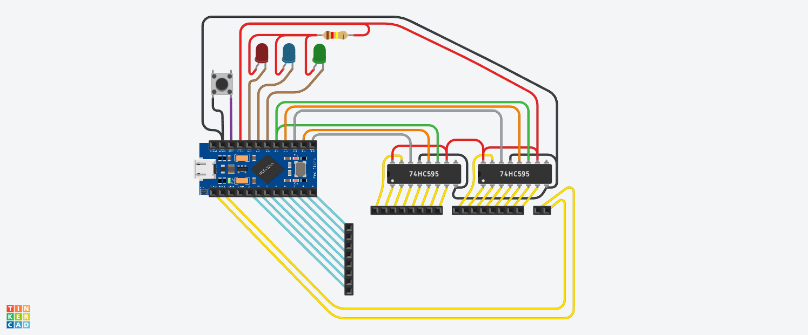

# Arduino Keyboard – 74HC595

Replace the dead controller of a **Samsung SDM4500P** (P/N KB2M001SPAAD) multimedia keyboard with an **Arduino Pro Micro (ATmega32U4)** and **two 74HC595 shift registers**. The Pro Micro enumerates as a USB HID keyboard plus consumer-control (media) device.

## Why shift registers?
The membrane matrix is 8 rows × 18 columns = 26 lines, more than a Pro Micro can spare. Two 74HC595s drive **16 columns**, the Pro Micro drives **2 columns** directly and reads the **8 rows** directly.

## Layout
| Path | Purpose |
|---|---|
| `samsung_keyboard_code/` | **Main firmware** (HID-Project) |
| `diagnostic_matrix/` | Row/col finder matching the final wiring – use to verify a build |
| `diagnostic_legacy/` | Original early diagnostic (rows via 595, columns direct – *old wiring*, kept for history) |
| `hardware/Keyboard_Mapping.xlsx` / `.csv` | Matrix → key table (row, col, normal, shift/NumLock-off layer) |
| `docs/images/` | Schematic, 74HC595 and Pro Micro pinouts |
| `docs/photos/` | Build photos (label, membrane, original IC, wiring, final test) |

## Pin map (final firmware)
| Signal | Pro Micro pin | Goes to |
|---|---|---|
| DS #1 | 14 (MISO) | 74HC595 #1 pin 14 |
| ST_CP #1 | 15 (SCK) | 74HC595 #1 pin 12 |
| DS #2 | 10 | 74HC595 #2 pin 14 |
| ST_CP #2 | 16 (MOSI) | 74HC595 #2 pin 12 |
| SH_CP (shared) | A0 | both pin 11 |
| Extra columns 16, 17 | 0 (RX), 1 (TX) | membrane |
| Rows 0–7 | 2, 3, 4, 5, 6, 7, 8, 9 | membrane (INPUT_PULLUP) |
| Caps / Num / Scroll LED | A2 / A3 / A1 | LEDs (active-low) |

Q0–Q7 of 595 #1 → columns 0–7, of #2 → columns 8–15. VCC/MR → 5 V, GND/OE → GND. See `docs/images/74HC595-pinout.webp`.

## How it scans
Each column is pulled LOW in turn; a row reading LOW means key (row, col) is pressed. Keys are looked up in `keyMappings[]`, mirroring `hardware/Keyboard_Mapping.csv`. Media keys use HID Consumer reports with auto-repeat (400 ms delay, 50 ms rate).

## Build & flash
1. Arduino IDE, board **Arduino Leonardo** (or SparkFun Pro Micro 5V/16MHz).
2. Install the **HID-Project** library.
3. Apply the HID-Project workaround below (rename `ImprovedKeyboard.cpp`).
4. Open `samsung_keyboard_code/samsung_keyboard_code.ino` and upload.

## HID-Project workaround (important)
Normal keys and the media/consumer keys would not work together using HID-Project's own `Keyboard` class. As a workaround, `HID-Project/src/MultiReport/ImprovedKeyboard.cpp` is renamed to `ImprovedKeyboard.cpp.bak`. That disables HID-Project's `Keyboard` implementation, so `Keyboard.press()/release()` resolve to the Arduino core's built-in `Keyboard.h`, while `Consumer` (media keys) and `BootKeyboard` (LED state) still come from HID-Project.

- This edits a library install, so it is lost on library update/reinstall – redo the rename after updating.
- Undo it by restoring the `.cpp` filename.
- Possible cleaner fix: a forked HID-Project with that file removed, vendored into the repo.

## Verify / remap
1. Flash `diagnostic_matrix`, open Serial Monitor at 115200.
2. Press a key → prints `Row r  Col c`.
3. Edit `keyMappings[]` and the CSV/XLSX.

## Known quirks / TODO
- **Left Shift (row 6, col 7) misbehaves during multi-key presses** – combos with it can drop or miss keys. Not yet fixed. Likely cause (unconfirmed): membrane matrix ghosting/blocking, since there are no per-key diodes. Things to try: check with `diagnostic_matrix` which combos fail, remap Left Shift to a different matrix position if possible, or compare against Right Shift (2,7), which is on a different row.
- Pins 0/1 are columns, so hardware UART is unavailable (USB CDC unaffected).
- LEDs are read via `BootKeyboard.getLeds()` while keys are sent via the core `Keyboard` (see workaround above); if LEDs don't follow lock state, add `BootKeyboard.begin()` in `setup()`.
- `keyMappings` is searched linearly per matrix cell each scan; fine at this size.
- In the spreadsheet, `5,1` is listed for both `1` and `2`; firmware correctly uses `5,2` for `2`. Second-function numpad entries are the NumLock-off layer, handled by the host OS.
- Some media keys (pg1–pg5, "i", help …) are mapped to brightness/zoom/logoff etc.; change to taste.

## License
GPL-3.0 – see [LICENSE](LICENSE).
